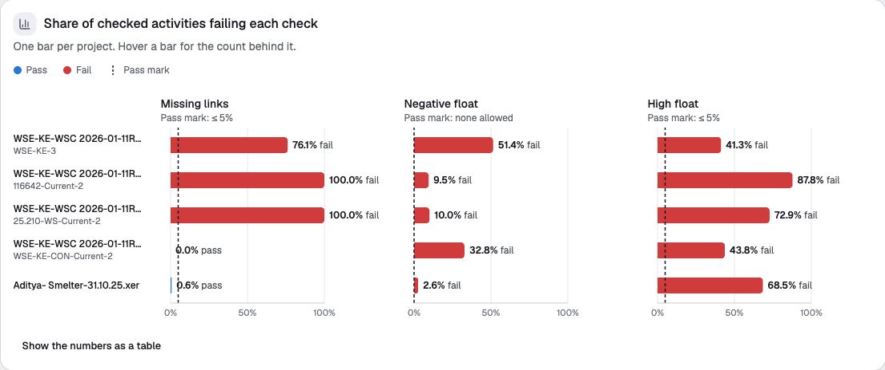

# XER Checker

A small web app that reads Primavera P6 schedule exports (`.xer`), lists the rows it can't use, and runs 3 basic schedule checks: **missing links**, **negative float** and **high float**. One chart compares every loaded project. Every rule is written down below and in the app.

Everything runs in your browser. Files are never uploaded.

**Live app:** [xer-checker.vercel.app](https://xer-checker.vercel.app)

## Sample files

The 2 sample files are real P6 exports found in public GitHub repositories, included here unchanged. Neither repository has a license file. They're in [`public/samples/`](public/samples/), and the app loads them from there.

| File | Repository | Downloaded | SHA-256 |
|---|---|---|---|
| `WSE-KE-WSC 2026-01-11R1.xer` (1,713,617 bytes) | [digitalvinyl/crunch](https://github.com/digitalvinyl/crunch) ([file](https://raw.githubusercontent.com/digitalvinyl/crunch/HEAD/WSE-KE-WSC%202026-01-11R1.xer)) | 2026-11-09 | `fc1fabcf2fcf557284a5fc1f1d0df842d593ed133e9fd16f6fe7f629af4712c8` |
| `Aditya- Smelter-31.10.25.xer` (1,289,227 bytes) | [darasaikumar123456-droid/p6-viewer-schedule-suite](https://github.com/darasaikumar123456-droid/p6-viewer-schedule-suite) ([file](https://raw.githubusercontent.com/darasaikumar123456-droid/p6-viewer-schedule-suite/HEAD/Aditya-%20Smelter-31.10.25.xer)) | 2026-11-09 | `93b9501285fdaa75f6c38bee4eb52b27f263991597cedae7f5f2e5a0107ccc2d` |

With both files loaded, the app's chart looks like this:



## What it does

1. **Load files.** Use the 2 sample files, or drop in your own `.xer` exports, several at once. Each file is read and checked in a background worker, so the page stays responsive.
2. **Broken rows.** Every row of every table is read. A row that can't be used is listed with its line number, the rule it breaks and what was done with it. Nothing is repaired by guessing.
3. **The 3 checks**, per project, on the checked activities (see [Rules](#rules)):

   | Check | Flags an activity when | Pass mark |
   |---|---|---|
   | Missing links | It has no predecessor (start milestones exempt) or no successor (finish milestones exempt) | ≤ 5% of checked activities |
   | Negative float | Its total float is below 0 working days | None allowed |
   | High float | Its total float is above 44 working days | ≤ 5% of checked activities with float |

4. **Review.** The chart shows each project's % against each pass mark. Below it are the flagged activities (sortable and searchable), the exempt milestones, broken rows, warnings, external links and loops for each file and project.

## Results for the 2 sample files

These are the numbers the app shows, which are also in the chart above.

**Files**

| File | P6 version | Projects | Activities | Links | Broken rows | Warnings | Loops |
|---|---|---|---|---|---|---|---|
| `WSE-KE-WSC 2026-01-11R1.xer` | 17.12 | 4 | 1,289 | 2,158 | 365, all F2 (calendar not in the file) | 365 (8 h a day assumed) | 0 |
| `Aditya- Smelter-31.10.25.xer` | 20.12 | 1 | 1,652 | 2,626 | 0 | 0 | 0 |

**Projects**

| File · project | Data date | Checked activities | Missing links | Negative float | High float |
|---|---|---|---|---|---|
| WSE · WSE-KE-3 | 2025-11-17 | 109 of 168 (1 finished, 58 level of effort left out) | 83 · 76.1% · **fail** | 56 · 51.4% · **fail** | 45 · 41.3% · **fail** |
| WSE · 116642-Current-2 | 2025-12-21 | 295 of 295 | 295 · 100.0% · **fail** | 28 · 9.5% · **fail** | 259 · 87.8% · **fail** |
| WSE · 25.210-WS-Current-2 | 2025-12-15 | 70 of 70 | 70 · 100.0% · **fail** | 7 · 10.0% · **fail** | 51 · 72.9% · **fail** |
| WSE · WSE-KE-CON-Current-2 | 2026-01-11 | 754 of 756 (1 finished, 1 level of effort left out) | 0 · 0.0% · pass | 247 · 32.8% · **fail** | 330 · 43.8% · **fail** |
| Aditya · Aditya- Smelter-Upda | 2025-10-31 | 1,448 of 1,652 (204 finished left out) | 9 · 0.6% · pass | 38 · 2.6% · **fail** | 992 · 68.5% · **fail** |

**What stands out**

- **WSE holds 4 projects, and 2 of them have no incoming logic.** Every activity in `116642-Current-2` and `25.210-WS-Current-2` has a successor but no predecessor, so all 365 fail missing links. The same 365 activities use 2 calendars that aren't in the file, which makes them broken rows (F2). They're kept, and their float is converted at 8 hours a day.
- **WSE-KE-3 has deep negative float.** It goes down to −282.9 working days (MST1300, on a 10-hour calendar), and just over half its checked activities are below 0.
- **Aditya's logic is almost complete:** only 9 activities have no successor. But 38 activities sit at exactly −1.0 day of float, and 68.5% have more than 44 days of float, up to 513 days.

## Cross-checked against an independent reader

Both files were also read with [PyP6Xer](https://github.com/HassanEmam/PyP6Xer) 2.0, a Python XER library, in a throwaway environment that isn't part of this repo:

- all 2,941 activities match on project, code, type, status, calendar, and total float in hours and in working days;
- all 4,784 links match on ID, both ends and link type;
- recounting the 3 checks from PyP6Xer's data gives the same numbers for all 5 projects.

Both readers assume 8 hours a day when an activity's calendar is missing, so for those 365 WSE activities the float in days agrees by construction.

## Rules

### Reading the file

- An XER file is tab-separated text. Line 1 starts with `ERMHDR` and gives the P6 version and export date. `%T` starts a table, `%F` lists its fields, each `%R` is a row, and `%E` ends the file.
- A file whose first line doesn't start with `ERMHDR` is refused, whatever its extension.
- The text is decoded as UTF-8 if it's valid, otherwise as Windows-1252. P6 doesn't say which it used.
- LF or CRLF ends a line, and a lone CR is part of a value. A value that starts with `"` is quoted and can run over several lines, with `""` standing for a quote. Newer P6 versions write calendar data this way.
- Every table is read and its rows counted. The checks use `PROJECT`, `CALENDAR`, `TASK` (activities) and `TASKPRED` (links). Each project in a file is reported separately.

### Broken rows

| ID | Rule | What happens |
|---|---|---|
| L1 | Line 1 doesn't start with `ERMHDR` | The whole file is refused |
| L2 | A field list (`%F`) or row (`%R`) comes before any table (`%T`) | Row skipped |
| L3 | A row comes before its table's field list | Row skipped |
| L4 | A row has a different number of fields from its field list, or a quoted value is never closed | Row skipped |
| L5 | A non-empty line that isn't `ERMHDR`, `%T`, `%F`, `%R` or `%E` | Line skipped |
| V1 | A key is empty (`proj_id`, `clndr_id`, `task_id`, `task_pred_id`) | Row skipped |
| V2 | The same key appears twice in a table | The first row is kept, later ones skipped |
| V3 | A number field isn't a number (the `*_id` fields, `day_hr_cnt`, `total_float_hr_cnt`) | A bad `*_id`: row skipped. Otherwise the field is treated as empty and the row kept |
| V4 | A date field can't be read (`last_recalc_date`) | Field treated as empty; the data date shows "unreadable" |
| F1 | The activity's project isn't in the file | Activity skipped, since it can't be placed |
| F2 | The activity's calendar is empty or isn't in `CALENDAR` | Activity kept, using 8 hours a day |
| F3 | A link's activity isn't in `TASK`, but its project is in the file | Link skipped |
| S1 | An activity is linked to itself | Link skipped |
| S2 | The same link (predecessor, successor and link type) appears more than once | The first is kept, later ones skipped |

- **Where the rules apply.** Value checks (V) apply only to the 4 tables the checks use. Every other table gets the layout checks (L).
- **One entry per skipped row.** A skipped row is listed once, for the first rule it breaks, in the order V1, V3 (IDs), V2, then F, then S. A kept row can be listed more than once.
- **Counting.** "Broken rows" counts lines, not problems.

### Checked activities

All activities in the project except finished ones, level-of-effort activities and WBS summary activities, applied in that order. The app counts how many were left out for each reason.

### Missing links

- Any link that isn't skipped counts, including links to projects outside the file, whatever the other activity's status.
- A start milestone with no predecessor, or a finish milestone with no successor, is exempt but listed.
- Each failing activity is counted once: no predecessor only, no successor only, or neither.

### Float

- The checker reads the total float P6 stored for each activity (`total_float_hr_cnt`). It doesn't recalculate the schedule, so **float is only meaningful if the schedule was calculated in P6 before it was exported**.
- Hours become working days using the hours per day of the activity's calendar. If the calendar is missing, or has no hours per day, 8 hours a day is assumed and listed as a warning.
- An unfinished activity with no float gets a warning and is left out of both float checks. The float %s are worked out on the checked activities that have float.
- Comparisons use unrounded values. Days and %s are shown to 1 decimal place. A % exactly at a pass mark passes.

### Pass marks

The pass marks follow the DCMA 14-point schedule assessment: missing links at most 5%, no negative float, and high float (over 44 working days) at most 5%. They are named constants in [`src/core/constants.ts`](src/core/constants.ts).

### External links, loops and warnings

- **External link:** a link whose other activity belongs to a project that isn't in the file. It isn't broken, it counts as a link, and it's listed under the project whose activity holds it.
- **Loop:** 2 or more activities that can each reach every other through links inside the file. Each loop is listed once for the file, and loops don't change the 3 checks.
- **Warnings** aren't counted as broken rows. There are 3 kinds:
  - the file has no closing `%E`, so it may be cut off;
  - an unfinished activity has no float;
  - an activity's hours per day fell back to 8.

## Run it locally

You need Node.js 20.19 or later (or 22.12 or later).

```bash
npm install
npm run dev
```

Then open the URL it prints. `npm run build` type-checks the code and writes a static site to `dist/`, and `npm run preview` serves that build.

## How it's built

- **Stack:** Vite, React and TypeScript (strict), with Tailwind CSS, shadcn/ui and Recharts. It's a static site, with no server, database or analytics.
- **[`src/core/`](src/core/):** plain TypeScript with no React or DOM. It turns a file's bytes into a result. It has the decoder, the line reader, the typed records, the broken-row rules, the 3 checks, loop detection and the constants.
- **[`src/worker/`](src/worker/):** runs the core in a Web Worker, one per file. The bytes are transferred in, and progress and the result come back.
- **[`src/ui/`](src/ui/):** the React components: the loader, chart, file and project switcher, overview, check cards, lists, and "How this works".
